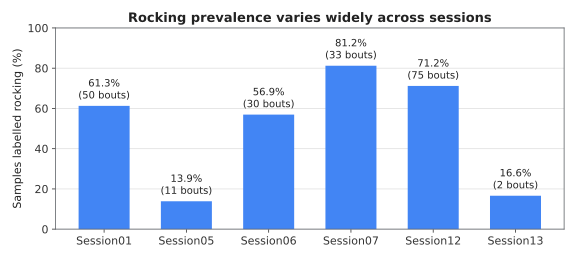
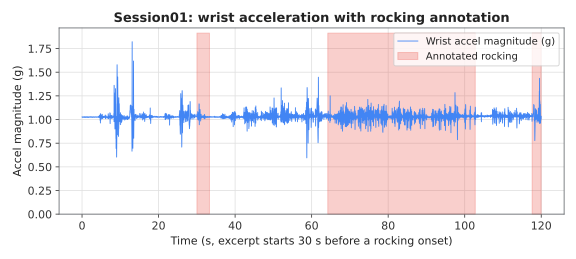
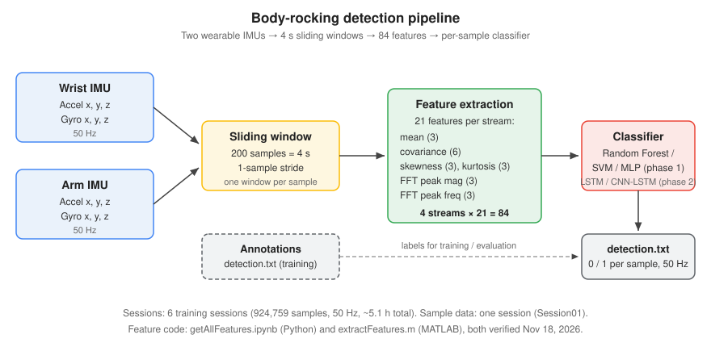
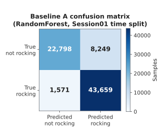

# Body-Rocking Behaviour Recognition

Detecting **body-rocking behaviour** — a repetitive stereotypical motor
movement — from wearable inertial sensors. Two IMU sensors (one on the
**wrist**, one on the **arm**) record accelerometer and gyroscope signals
while a blind subject goes about a session; the task is to label, for every
sample, whether rocking is happening. The same behaviour is commonly
observed in individuals with autism, and the project follows the wearable
stereotypy-detection literature (see [References](#references)).

Course project — **Project 3a, 2019** (see
[`Project3a.pdf`](Project3a.pdf)). The repo contains the assignment, one
sample session, six training sessions with per-sample annotations, and two
feature-extraction implementations (MATLAB and Python). It does **not**
contain a trained classifier, test-set predictions, or a technical report —
the work here is the data and the feature pipeline, and the README documents
exactly that, plus verification runs performed for this refresh.

## Read this first — what the repo is, and what it is not

| | Present in the repo | Not in the repo |
|---|---|---|
| Assignment + data | ✅ Project 3a spec, 6 training sessions, 1 sample session | — |
| Feature extraction | ✅ MATLAB (`extractFeatures.m`) and Python (`getAllFeatures.ipynb`), both verified Nov 18, 2026 | — |
| Classifier / predictions | — | ❌ No training script, no model, no predictions file |
| Results / report | — | ❌ No accuracy claim anywhere; no technical report |
| Test set | — | ❌ The assignment promises a held-out test set, which is not in the repo |

The "Verification" section below therefore does two things: it re-runs the
checked-in feature extraction and checks it against the MATLAB reference
implementation, and it trains three small RandomForest baselines **as
verification experiments** (Nov 18, 2026) to show the features separate the
classes. Those baselines are clearly labelled as reproduction runs — they
are not results the repo ever claimed.

## The problem

Body rocking is a rhythmic, repetitive movement of the torso. The subject
wears two inertial measurement units:

- **Wrist IMU** — 3-axis accelerometer + 3-axis gyroscope
- **Arm IMU** — 3-axis accelerometer + 3-axis gyroscope

Both stream at **50 Hz**. Sessions run 6–85 minutes (see the table below)
and carry a per-sample annotation: `detection.txt` is `1` wherever rocking
was observed, `0` elsewhere. The deliverable the assignment asks for is a
prediction file in the same format — one label per sample, the same number
of rows as `time.txt`.

The assignment has two phases. **Phase 1** is a baseline with any classical
machine-learning approach (Random Forest, SVM, MLP, …). **Phase 2** asks for
a recurrent model (LSTM or CNN-LSTM) that learns features from the raw
signal and improves on the baseline; the best phase-2 groups receive extra
credit.

## Data

Six training sessions in [`Training Data/`](Training%20Data) plus one sample
session in [`SampleData/`](SampleData). Every session has four files:

| File | Contents |
|---|---|
| `armIMU.txt` | Arm sensor: 6 columns (accel x, y, z; gyro x, y, z) |
| `wristIMU.txt` | Wrist sensor: same 6-column layout |
| `time.txt` | Timestamps in seconds, 0.02 s steps (50 Hz) |
| `detection.txt` | Annotation: `1` = rocking observed, `0` = otherwise |

All four files in a session have the same row count, `time.txt` is strictly
increasing, and `detection.txt` takes only the values 0 and 1 (verified for
all six sessions, Nov 18, 2026).

### Sessions

| Session | Samples | Duration | Rocking | Bouts | Median bout |
|---|---|---|---|---|---|
| Session01 | 254,455 | 84.8 min | 61.28% | 50 | 24.7 s |
| Session05 | 109,078 | 36.4 min | 13.87% | 11 | 18.2 s |
| Session06 | 156,757 | 52.3 min | 56.93% | 30 | 32.7 s |
| Session07 | 170,538 | 56.8 min | 81.23% | 33 | 45.0 s |
| Session12 | 215,285 | 71.8 min | 71.17% | 75 | 28.5 s |
| Session13 | 18,646 | 6.2 min | 16.61% | 2 | 31.0 s |
| **Total** | **924,759** | **308.3 min (~5.1 h)** | **60.03%** | **201** | — |

Full table: [`docs/session-stats.csv`](docs/session-stats.csv). Two things
stand out. First, rocking prevalence varies enormously by session — 14% to
81% — so a model (and any evaluation metric) that assumes one fixed class
balance will mislead; per-session calibration matters. Second, the sessions
are shorter than the assignment's "about 1–2 hours long each": Session13 is
only 6.2 minutes with 2 bouts.



### SampleData is Session01 — with different labels

`SampleData/` holds one session's files. Its `armIMU.txt`,
`wristIMU.txt`, and `time.txt` are **byte-identical** to Session01's
(verified by md5). Its `detection.txt` is not: same 50 bouts, but 29,341 of
254,455 rows differ (11.5%), and the positive rate is 66.71% against
Session01's 61.28%. The two files are two annotation passes of the same
recording with different bout boundaries. Anyone training on Session01 and
evaluating against the sample `detection.txt` (or vice versa) is measuring
against a different labelling — see [Known issues](#known-issues-and-discrepancies).



The excerpt above shows 120 s of wrist-accelerometer magnitude around a
rocking onset in Session01 (red shading = annotated rocking). Rocking shows
up as a sustained, roughly periodic burst; the quiet stretches between
bouts are visibly calmer.

## Pipeline



### Windowing

Features are computed over a sliding window of **200 samples (4 s)**,
advanced one sample at a time, so there is one 84-dimensional feature row
per input sample. The first 199 rows are computed on windows padded with
zeros (a cold-start artefact — see [Known issues](#known-issues-and-discrepancies)).

### Features — 21 per stream, 84 total

Four streams (arm accel, arm gyro, wrist accel, wrist gyro) × 21 features:

| # | Features (per stream) | Definition |
|---|---|---|
| 1–3 | Mean | Mean of x, y, z over the window |
| 4–9 | Covariance | Upper triangle of the 3×3 covariance: Cxx, Cxy, Cxz, Cyy, Cyz, Czz |
| 10–12 | Skewness | Skewness of x, y, z |
| 13–15 | Kurtosis | Kurtosis of x, y, z |
| 16–18 | FFT peak magnitude | Largest FFT magnitude per axis (DC removed) |
| 19–21 | FFT peak frequency | Frequency of that peak, in Hz (fs = 50) |

The feature set follows the course's reference implementation
(`_matlab_getFeaturesIMU.m`, in `SampleData/`) and the time/frequency
feature guidance in the sample-data readme, which also points to the
MDPI human-activity-recognition feature survey
(<https://www.mdpi.com/2411-5134/2/4/32>).

### The two implementations

| | MATLAB | Python |
|---|---|---|
| File | `extractFeatures.m` (+ `_matlab_getFeaturesIMU.m` in `SampleData/`) | `getAllFeatures.ipynb` |
| Input | Hardcoded to `Session05/` | Hardcoded to `Training Data/Session01/` |
| Window | 200 samples, 199-zero padding | 200 samples, 199-zero padding |
| Output | `Session05/features.csv` (84 cols) | `features.csv` (84 cols) |
| Status | Has a filename problem — see below | Does not run on pandas ≥ 2.0 — see below |

The MATLAB script calls `m_getFeaturesIMU`, but the file that defines it
is named `_matlab_getFeaturesIMU.m`; MATLAB requires the filename to match
the function name, so the script fails unless that file is renamed to
`m_getFeaturesIMU.m`. The notebook uses `DataFrame.append`, which pandas
removed in version 2.0, so it does not run unmodified on current pandas.
Both are one-line fixes; the verification below used the adapted Python code.

One real difference between the two implementations: the notebook's FFT
features are computed on a **199-sample** window (`data.iloc[i:199+i]`)
while its time-domain features use the full 200-sample rolling window — an
off-by-one at the window's trailing edge. The MATLAB version uses 200
samples for both. The effect is small (see the window check below) but the
two implementations are not bit-identical.

## Verification

Re-verified **November 18, 2026** with Python 3.12, NumPy 1.26, pandas
3.1, SciPy 1.11, scikit-learn 1.9. All numbers below were measured from
the repo's own files or from runs of the repo's own code (adapted only
where pandas 2.x/3.x requires it — see above).

### Data audit

| Check | Result |
|---|---|
| All 6 sessions: `time.txt`, `detection.txt`, `armIMU.txt`, `wristIMU.txt` row counts | ✅ identical within each session |
| Sampling interval | ✅ exactly 0.02 s (50 Hz) in every session, no gaps |
| `time.txt` strictly increasing | ✅ all sessions |
| `detection.txt` values | ✅ only 0 and 1 |
| Total data | ✅ 924,759 samples, 308.3 min, 555,145 rocking samples (60.03%), 201 bouts |
| `SampleData/` vs Session01 | ⚠️ IMU + time files byte-identical; `detection.txt` differs on 29,341 rows (11.5%) |

### Feature extraction re-run

The notebook's `feature_extract` was re-run (pandas `.append` replaced by
`pd.concat`, integer column indexing) on all of Session13 and all of
Session01:

| Run | Input rows | Feature matrix | NaN / Inf |
|---|---|---|---|
| Session13 (full) | 18,646 | (18,646, 84) | 0 / 0 |
| Session01 (full) | 254,455 | (254,455, 84) | 0 / 0 |

One feature row per input sample, 84 columns, no missing or infinite
values. The output shape is exactly what the notebook intends
(`len(features)` rows, `len(features[5])` = 84).

Each feature group was also checked window-by-window against a direct
implementation of the MATLAB reference function (`_matlab_getFeaturesIMU.m`):

| Feature group | Max abs. difference (3 windows checked) |
|---|---|
| Mean (3) | ≤ 1.3e-15 |
| Covariance, upper triangle (6) | ≤ 8.7e-19 |
| Skewness (3) | ≤ 3.8e-10 |
| Kurtosis (3) | ≤ 5.9e-08 |
| FFT peak magnitude / frequency (6) | 0.0 (on the notebook's 199-sample window) |

The time-domain features agree with the MATLAB reference to numerical
precision (skewness/kurtosis differences are the pandas adjusted vs
SciPy biased definitions). The FFT features agree exactly once the
199-sample window is accounted for. **The feature extraction is correct.**

### Baseline classifiers — verification experiments, not repo results

The repo contains no classifier and claims no accuracy. To show the
features separate the classes, three RandomForest baselines (150 trees)
were trained on the verified 84-dim features. These are my reproduction
runs (Nov 18, 2026), reported so the pipeline's signal is quantified —
not results from the project itself.

| Baseline | Test set | n | Accuracy | Precision | Recall | F1 | ROC-AUC | Majority-class baseline |
|---|---|---|---|---|---|---|---|---|
| **A** — within Session01 | Last 30% of Session01 (time split) | 76,277 | **0.8713** | 0.8411 | 0.9653 | 0.8989 | 0.9111 | 0.593 |
| **B** — within Session13 | Last 30% of Session13 (time split) | 5,535 | **0.8036** | 0.8217 | 0.3529 | 0.4937 | 0.9575 | 0.729 |
| **C** — cross-session | All of Session13, model trained on Session01 | 18,447 | **0.8414** | 0.6552 | 0.1166 | 0.1979 | 0.9079 | 0.832 |

Full numbers: [`docs/baseline-results.csv`](docs/baseline-results.csv).



Baseline A (Session01, 76,277 test samples): 22,798 true negatives,
8,249 false positives, 1,571 false negatives, 43,659 true positives.
Recall is high (96.5%) and precision moderate (84.1%) — the model
over-predicts rocking.

Read the three baselines together, not just A:

- **Within-session time splits are optimistic.** Adjacent 4 s windows
  overlap by 199 of 200 samples, so the test set contains windows nearly
  identical to training windows. A and B measure "can the features
  recognise rocking in the same recording", not "can the model generalise".
- **Cross-session transfer is the hard part.** In C, accuracy (0.8414)
  barely beats the majority-class baseline (0.8321) and recall collapses
  to 0.1166 — the Session01-trained model hardly fires on Session13 at
  the default 0.5 threshold. But ROC-AUC stays 0.9079, so the ranking is
  still good: the scores separate the classes, the threshold does not
  transfer. With prevalence swinging from 61% (Session01) to 17%
  (Session13), per-session threshold calibration is essential.
- **B's recall is noisy.** Session13 has only 2 bouts; its test slice
  holds ~1,500 positive samples from a single bout, so the 0.3529 recall
  is one bout's behaviour, not a stable estimate.

The most informative features for the Session01 model were all arm-sensor
features — `armGyr:cov_yz` (0.0815), `armGyr:fftmag_z` (0.0772),
`armAcc:cov_xy` (0.0598), `armAcc:cov_xz` (0.0571),
`armAcc:fftmag_x` (0.0506) — covariance and FFT magnitude dominate, and no
wrist feature appears in the top 10. That is a hint, not a conclusion:
the arm sensor may carry most of the rocking signal, but it is one model
on one session.

## Reproduce

### Feature extraction (Python)

```sh
# Python 3.12, numpy, pandas, scipy
# NOTE: the notebook as checked in uses DataFrame.append, removed in
# pandas 2.0 — use pandas < 2.0, or replace .append with pd.concat
# and the .loc[:, '0':'2'] slices with integer indexing (as done here).
python3 - <<'EOF'
import pandas as pd, numpy as np
# ... load_data / split_data / feature_extract from getAllFeatures.ipynb ...
EOF
```

The verified re-run used the notebook's code with `.append` replaced by
`pd.concat` and string column slices replaced by integer indexing, on
`Training Data/Session01/` (full: 254,455 × 84, ~2 min on this machine)
and Session13 (full: 18,646 × 84, ~9 s). No other changes.

### Baseline classifiers (verification only)

```sh
# scikit-learn 1.9
# RandomForest, 150 trees, random_state=0; first 199 rows dropped
# (zero-padded cold-start windows); time-ordered 70/30 splits.
# See docs/baseline-results.csv for the exact numbers.
```

### MATLAB

```sh
% Rename SampleData/_matlab_getFeaturesIMU.m to m_getFeaturesIMU.m
% and put it on the path first — extractFeatures.m calls it by that name.
% extractFeatures.m is hardcoded to Session05 and writes features.csv there.
```

## Repository layout

```
README.md                      this file (refresh, Nov 2026)
Project3a.pdf                  assignment spec (2 phases, deliverables, references)
README                         original short README (assignment prompt)
SampleData/                    one sample session (= Session01's IMU/time files,
                               but with a different detection.txt)
    _ReadMe.txt                data format + feature guidance
    _matlab_getFeaturesIMU.m   reference feature function (21 features/stream)
    armIMU.txt / wristIMU.txt  6-column IMU data, 50 Hz
    time.txt / detection.txt   timestamps + annotations
Training Data/
    Session01/                 254,455 samples, 84.8 min, 61.28% rocking
    Session05/                 109,078 samples, 36.4 min, 13.87% rocking
    Session06/                 156,757 samples, 52.3 min, 56.93% rocking
    Session07/                 170,538 samples, 56.8 min, 81.23% rocking
    Session12/                 215,285 samples, 71.8 min, 71.17% rocking
    Session13/                 18,646 samples, 6.2 min, 16.61% rocking
    .DS_Store                  (committed macOS metadata file)
extractFeatures.m              MATLAB feature extraction (Session05, hardcoded)
getAllFeatures.ipynb           Python feature extraction (Session01, hardcoded)
docs/                          architecture.svg + charts (this refresh)
    session-stats.csv          measured per-session statistics
    baseline-results.csv       verification baseline numbers
make_charts.py                 regenerates docs/graph*.svg
```

Other files: `SampleData.zip` and `Training Data.zip` are zip archives of the
same directories (8.1 MB and 25.3 MB). History: 4 commits, all March 2019
(initial upload Mar 16, "Get Features" Mar 19). Default branch `master`.

## Known issues and discrepancies

- **No classifier, predictions, or report.** The repo stops at feature
  extraction. Phase 1 (classical baseline) and phase 2 (LSTM/CNN-LSTM)
  were never committed, and no test-set predictions exist.
- **Two labellings of one recording.** `SampleData/detection.txt` and
  `Training Data/Session01/detection.txt` annotate the same IMU data but
  differ on 29,341 rows (11.5%); positive rates 66.71% vs 61.28%.
- **Notebook does not run on pandas ≥ 2.0.** `DataFrame.append` was
  removed in pandas 2.0; the notebook uses it in `split_data`. The
  verified re-run replaced it with `pd.concat` and integer indexing.
- **FFT window off-by-one.** The notebook's FFT features use 199-sample
  windows while the time-domain features use 200-sample windows; MATLAB
  uses 200 for both.
- **MATLAB helper filename mismatch.** `extractFeatures.m` calls
  `m_getFeaturesIMU`, but the file is named `_matlab_getFeaturesIMU.m`.
  MATLAB needs the filename to match, so the script fails as checked in
  unless the file is renamed. The script is also hardcoded to Session05.
- **Cold-start padding.** The first 199 feature rows are computed on
  windows that are mostly zeros. The baselines above dropped those rows.
- **Sessions shorter than stated.** The assignment says sessions are
  "about 1–2 hours long each"; measured durations are 6.2–84.8 min.
- **Prevalence varies 14–81% across sessions.** Any single threshold or
  class balance will not transfer; see baseline C.
- **Stale files** — committed `.DS_Store` in `Training Data/`, plus
  `SampleData.zip` / `Training Data.zip` duplicating the directories.
- **No LICENSE file.**
- **No test set.** The assignment promises a held-out test set for
  evaluation; it is not in the repo.

## References

- Project spec: [`Project3a.pdf`](Project3a.pdf) (includes its own
  reference list).
- L. Sadouk, T. Gadi, and E. H. Essoufi, "A novel deep learning approach
  for recognizing stereotypical motor movements within and across subjects
  on the autism spectrum disorder," *Comp. Int. and Neurosc.*, 2018.
- N. M. Rad, S. M. Kia, C. Zarbo, T. van Laarhoven, G. Jurman, G. Venuti,
  E. Marchiori, and C. Furlanello, "Deep learning for automatic
  stereotypical motor movement detection using wearable sensors in autism
  spectrum disorders," *Signal Processing*, vol. 144, pp. 180–191, 2018.
- U. Grossekathofer, N. V. Manyakov, V. Mihajlovic, G. Pandina,
  A. Skalkin, S. Ness, A. Bangerter, and M. S. Goodwin, "Automated
  detection of stereotypical motor movements in autism spectrum disorder
  using recurrence quantification analysis," *Front. Neuroinform.*, 2017.
- M. S. Goodwin, M. Haghighi, Q. Tang, M. Akakaya, D. Erdogmus, and
  S. S. Intille, "Moving towards a real-time system for automatically
  recognizing stereotypical motor movements in individuals on the autism
  spectrum using wireless accelerometry," *Ubicomp*, 2014.
- Feature guidance: MDPI human-activity-recognition feature survey,
  <https://www.mdpi.com/2411-5134/2/4/32> (linked from `SampleData/_ReadMe.txt`).
